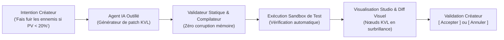

# KARACTIRAGE — VISION CIBLE DE LA VERSION FINALE DU MOTEUR
*Guide de Référence Définitif : Philosophie, Expérience Utilisateur, Architecture et Cas d'Usage Détaillés*

---

> **Règle d'or du document** : Ce document constitue la boussole absolue et immuable du projet KaractiRage. Chaque nouvelle brique technique (2D, 3D, KVL, IA, audio, physique) doit être conçue en convergence avec la vision globale décrite ici.

---

## 1. La Vision et le Positionnement : Pourquoi KaractiRage ?

### Le constat de l'industrie (2026)
Les moteurs dominants du marché (Unreal Engine 5, Unity) souffrent de trois maux profonds :
1. **L'obésité matérielle** : Installations de 50 à 100 Go, shaders qui compilent pendant des heures, obligation d'avoir une carte graphique dédiée à 1500 € et 32 Go de RAM simplement pour déplacer un cube.
2. **La complexité intimidante** : Les débutants et créateurs indépendants se retrouvent noyés dans des toiles d'araignées de câbles (*Blueprints spaghetti*) ou du code impératif complexe où la moindre erreur fait planter tout le jeu.
3. **L'illusion de l'IA "boîte noire"** : Les solutions qui prétendent générer un jeu d'un simple prompt produisent du code obscur, indéboguable et impossible à personnaliser.

### La réponse de KaractiRage
KaractiRage est l'antithèse absolue de cette dérive :
* **Un binaire ultra-léger** : Moins de **60 Mo** pour le Studio complet, **moins de 15 Mo** pour un jeu 2D exporté, **moins de 40 Mo** pour un jeu 3D stylisé.
* **Démarrage instantané** : Moins de **300 millisecondes**. Aucun splash screen publicitaire, aucun compte obligatoire.
* **Accessibilité universelle (*Low-End First*)** : 60 FPS constants sur un PC portable sans carte graphique (iGPU Intel/AMD, Apple Silicon de base, PC de classe d'école) avec adaptation dynamique continue.
* **Le continuum d'apprentissage KVL** : Même modèle de données sous-jacent, que l'on manipule en français simple, en blocs visuels élégants ou en code Rust direct.
* **L'IA agentique contrôlée** : L'IA ne génère pas de code sauvage, elle produit des patchs visuels KVL testés en sandbox, validables ou annulables en 1 clic.

---

## 2. Création et Structure d'un Projet

### 2.1 Le Lanceur et le Créateur de Projet
Au premier lancement de l'exécutable `karactirage` :
1. Une fenêtre sobre et épurée s'ouvre instantanément.
2. Un sélecteur de gabarits visuels propose :
   * **Aventure & Donjon (Top-Down / RPG)** : Déplacement libre 8 directions, grilles de collisions, interactions et dialogues.
   * **Plateforme & Action (2D / 2.5D)** : Moteur de gravité, sauts impulsionnels, plateformes traversables et pièges.
   * **Shoot'em Up & Espace (Inertie Newtonienne)** : Poussée vectorielle, tirs balistiques, débris et astéroïdes.
   * **Énigmes & Sokoban (Grille & Blocs)** : Déplacement quantifié, blocs poussables et dalles de pression.
   * **Monde 3D Stylisé (Aventure Low-Poly)** : Caméra troisième personne, terrain 3D en maillage glTF, éclairage ambiant et ombres douces.
   * **Toile Vierge (Blank Canvas)** : Scène minimale pour tout bâtir de zéro.
3. Le créateur renseigne le nom du projet et le dossier cible. En moins de **50 ms**, l'arborescence est générée.

### 2.2 L'Arborescence Ouverte et Lisible
KaractiRage refuse les formats propriétaires obscurs. Tout est inspectable et versionnable avec Git :

```text
MonJeu/
├── KaractiRage.project.json       # Métadonnées du projet, profil par défaut, cible 60 FPS
├── assets/
│   ├── scenes/                    # Fichiers de scènes JSON lisibles
│   │   ├── hub_village.scene.json
│   │   └── donjon_niveau1.scene.json
│   ├── scripts/                   # Graphes de logique visuelle KVL
│   │   ├── coffre_magique.kvl.json
│   │   └── dialogue_gardien.kvl.json
│   ├── sprites/                   # Spritesheets, textures 2D (PNG, WebP)
│   ├── models/                    # Modèles 3D (glTF / GLB, voxels)
│   ├── audio/                     # Échantillons sonores et presets synthé
│   └── fonts/                     # Polices bitmap et vectorielles
└── exports/                       # Binaires exportés (Win, Mac, Linux, Web)
```

---

## 3. Le Studio KaractiRage : Ergonomie & Navigation

Le Studio est un atelier visuel fluide et unifié, sans fenêtres flottantes encombrantes.

```
+----------------------------------------------------------------------------------------------------+
| [KARACTIRAGE STUDIO]  [Projet: Donjon]  [Scene: Salle_Emeraudes v]       [Profil: 60 FPS | CPU: 380us] |
| [V: SELECT] [B: PINCEAU] [T: TUILE >] [X: GOMME] [3D: PERSPECTIVE] [+ SPAWN (P)] [? AIDE (H)] [TAB: JOUER]|
+-------------------------------------------------------------------------+--------------------------+
|                                                                         | INSPECTEUR ECS D'ENTITÉ  |
|                                                                         | Nom : Gardien_Ancien     |
|                       VIEWPORT TEMPS RÉEL (2D / 3D)                     | Tag : npc                |
|                                                                         | Transform2D / 3D         |
|   * Caméra défilante douce avec coordonnées monde                       | [>] Collider (Solide)    |
|   * Rendu défilant des rivets, dalles et ombres portées                 | [>] Dialogue (KVL Actif) |
|   * Curseur fantôme (Ghost Box) pour prévisualisation de peinture       | [>] Health (Vie: 3/3)    |
|   * Frustum de caméra avec culling sans coût mémoire                    |                          |
|                                                                         | LOGIQUE KVL ASSOCIEE     |
|                                                                         | [Vue: Simplifiée / Dépliée]|
|                                                                         | [ Contact -> Dialogue ]  |
+-------------------------------------------------------------------------+--------------------------+
| BANDEAU INFERIEUR : RUBAN PÉDAGOGIQUE & CONSOLE RÉACTIVE KVL (LOGIQUE EN DIRECT)                   |
| > [node_01] Contact Joueur -> [node_02] Afficher Dialogue "Gardien" -> [node_03] Etape Quête = 1    |
+----------------------------------------------------------------------------------------------------+
```

### 3.1 La Bascule Sacrée `TAB` (Zéro Temps Mort)
* En plein jeu, le créateur appuie sur **`TAB`** : le gameplay s'arrête net, la simulation se suspend sans saccade.
* Le studio s'affiche par-dessus : on peut attraper le joueur à la souris, corriger un saut, rajouter une caisse ou modifier un dialogue.
* On réappuie sur **`TAB`** : le jeu reprend instantanément avec les nouveaux réglages.

### 3.2 Outils de Création Directe dans le Viewport
* **Outil Sélection (`V`)** : Clic pour inspecter, déplacer à la souris avec magnétisme de grille optionnel.
* **Outil Pinceau (`B`)** : Peinture continue par glisser de tuiles ou volumes avec **détection anti-doublon spatial automatique**.
* **Sélecteur de Tuiles / Objets (`T`)** : Cycle instantané du matériau ou de l'entité à peindre (Murs, Pièges, Pièces, Caisses, Dalles, PNJ, Ennemis).
* **Outil Gomme (`X`) & Clic Droit Rapide** : Effacement d'entités au clic droit dans le viewport, avec protection inviolable de l'entité Joueur.

---

## 4. Importation et Gestion des Assets (2D, 3D, Audio)

KaractiRage applique le principe de **l'ingestion sans friction** : aucun outil de conversion externe lourd n'est requis.

### 4.1 Assets 2D (Sprites, Décors, Tuiles)
* **Glisser-Déposer (Drag & Drop)** : Glisser une image PNG ou WebP dans la fenêtre du Studio l'importe instantanément.
* **Découpage de Spritesheets automatique** : Détection des cellules sur grille régulière (ex: 16x16, 32x32) ou par boîte englobante de transparence alpha.
* **Générateur d'animations 2D** : Sélection d'une suite de cellules $\rightarrow$ Nommage de l'animation (`idle`, `walk`, `jump`) $\rightarrow$ Cadence en FPS.

### 4.2 Assets 3D (Modèles, Maillages, Animations)
* **Format Standard glTF / GLB** : KaractiRage adopte `glTF 2.0` (format universel de Khronos Group, exportable depuis Blender en 1 clic).
* **Génération automatique de colliders 3D** :
  * Lors de l'import, le moteur propose en 1 clic : *Boîte englobante AABB*, *Sphère*, *Capsule* ou *Coque convexe allégée* pour les calculs physiques ultra-rapides.
* **Extraction des animations squelettiques** : Les pistes d'armature (Run, Attack, Idle) sont indexées et contrôlables directement par des nœuds d'action KVL (`PlayAnimation3D:Run`).
* **Matériaux Stylisés PBR Low-End** : Rendu Cel-shaded / Toon avec contours sombres, insensible à la baisse de framerate et sublime visuellement.

### 4.3 Système Audio : Le Double Moteur (Synthèse Procédurale + Échantillons)
Pour rester fidèle au principe *Low-End*, KaractiRage propose :
1. **La Synthèse Procédurale Zéro-Fichier** :
   * Génération de sons en temps réel par ondes mathématiques (sinus, carré, triangle, bruit blanc) pour les sauts, tirs lasers, bruits de pas, pièces, alarmes et machine à écrire des dialogues.
   * Empreinte disque de ces sons : **0 octet**.
2. **L'Import d'Échantillons & Musiques (WAV, OGG, QOA)** :
   * Drag & drop de fichiers audio pour les thèmes musicaux et voix d'ambiance.
   * Lecture avec contrôle de pitch, volume et spatialisation sonore 2D/3D (atténuation selon la distance de la caméra).

---

## 5. Le Continuum Logique KVL : Créer sans Coder

KVL (*Karacti Visual Logic*) est le cœur battant du moteur. Il élimine la barrière du code tout en offrant la rigueur du typage strict.

### 5.1 Niveau 1 : Le Mode Guidé (Questionnaire d'Intention)
Pour concevoir une mécanique sans jamais tracer de câble :
* L'utilisateur clique sur **`[+ NOUVELLE MÉCANIQUE]`**.
* Le studio affiche un questionnaire ergonomique en français :
  1. *Quel est l'élément déclencheur ?* $\rightarrow$ [ Le joueur interagit avec le PNJ ]
  2. *Y a-t-il une condition ?* $\rightarrow$ [ Le joueur possède au moins 3 Clés ]
  3. *Quelle est la conséquence ?* $\rightarrow$ [ Ouvrir la Porte et Accorder 100 Points ]
* KaractiRage compile instantanément cette intention en graphe KVL valide.

### 5.2 Niveau 2 : Le Mode Visuel (Blocs Composés Dépliables)
* Dans l'inspecteur d'entité, la logique apparaît sous forme de blocs horizontaux clairs :
  `[ Contact Pièce ] ---> [ Ajouter Score (+10) ] ---> [ Détruire Objet ]`
* **Le Dépliage Progressif** : En appuyant sur **`ESPACE`**, le bloc macro s'ouvre et révèle ses broches d'entrée/sortie (`Trigger In`, `Trigger Out`), permettant aux créateurs d'intercaler de nouvelles conditions.

### 5.3 Niveau 3 : Le Mode Expert (Câblage Visuel Intégral)
* Vue nodulaire complète avec tracé de fils de connexion élastiques de Bresenham.
* Broches typées par couleur :
  * ⚪ Blanc : Flow d'exécution (`Trigger`)
  * 🟡 Jaune : Entiers / Scores / Quantités (`Int`)
  * 🔵 Cyan : Textes / Noms (`String`)
  * 🟢 Vert : Booléens (`Bool`)
  * 🟣 Violet : Coordonnées spatiales (`Vector2` / `Vector3`)
* **Sécurité Absolue** : Le validateur statique empêche de brancher un texte sur une broche de santé ou de créer une boucle infinie incontrôlée.

---

## 6. Narration, Dialogues, Quêtes & Cinématiques

KaractiRage intègre la dimension narrative au même niveau que le gameplay.

### 6.1 Le Système de Dialogues KVL
* Boîte de dialogue rétro/sci-fi adaptative au premier plan.
* **Effet machine à écrire rythmé (38 car/s)** avec synthèse sonore de cliquetis type RPG 16-bit.
* **Choix multiples interactifs** : boutons `[1]`, `[2]` cliquables à la souris ou actionnables au clavier (touches numériques).
* Les choix de dialogue mettent à jour instantanément les variables KVL et orientent la suite des événements.

### 6.2 Le Suivi de Quêtes Dynamique (`QuestTracker`)
* Gestion automatique des objectifs : Quête active, étape courante, étape cible.
* Widget d'affichage HUD en haut à droite avec notifications visuelles et fanfare sonore triomphale (`SoundType::QuestSuccess`) lors de l'accomplissement.

### 6.3 Le Moteur de Cinématiques (Timeline Déterministe)
Pour raconter une histoire sans vidéo pré-rendue lourde :
* **Piste Timeline intégrée** :
  * Déplacement fluide de la caméra le long d'une courbe de Bézier.
  * Déclenchement de répliques de dialogue à des temps précis.
  * Animation de personnages (ex: le boss qui descend du plafond).
  * Tremblement d'écran (*Screen Shake*) et fondus au noir.
* **Poids sur le disque** : Moins de **5 Ko** (simple fichier JSON de trajectoires et de marqueurs temporels KVL).

---

## 7. L'Assistant IA Agentique (*L'Agentic Studio Co-Pilot*)

KaractiRage intègre l'intelligence artificielle comme un **collègue artisan auditable**, et jamais comme une boîte noire.



### Le Protocole Strict de l'IA KaractiRage :
1. **L'IA ne génère jamais de code impératif brut sans contrôle** : Elle opère exclusivement sur le schéma KVL typé.
2. **Génération de patch traçable** : L'IA propose un ensemble de nœuds et de connexions visibles dans le Studio avec une couleur distincte (halo violet).
3. **Validation sandboxée** : Avant de proposer le patch à l'utilisateur, l'interpréteur simule 100 pas d'exécution pour garantir l'absence de boucle infinie.
4. **Rollback instantané** : L'utilisateur peut tester en jeu avec `TAB`, et d'un seul clic sur `Annuler`, revenir à l'état exact antérieur.

---

## 8. Exportation & Distribution Multiplateforme en 1 Clic

À la fin de la création, le déploiement ne demande aucune configuration complexe de SDKs :

| Plateforme Cible | Format Produit | Poids Moyen (2D) | Poids Moyen (3D Stylisée) | Caractéristiques |
| :--- | :--- | :--- | :--- | :--- |
| **Windows** | Fichier unique `.exe` | ~8 Mo | ~25 Mo | Portatif, zéro DLL manquante, direct DirectX/Vulkan/Software. |
| **macOS** | Bundle universel `.app` | ~12 Mo | ~30 Mo | Support natif Apple Silicon (M1/M2/M3/M4) et Intel 64-bit. |
| **Linux** | Binaire autonome ELF | ~8 Mo | ~25 Mo | Compatible toutes distributions récentes, zéro dépendance externe. |
| **Web (Navigateur)** | Dossier WebAssembly HTML5 | ~3.5 Mo | ~15 Mo | Prêt pour itch.io, hébergement sur n'importe quel serveur statique. |

### Souveraineté du Jeu Final :
* Aucun compte KaractiRage requis pour jouer.
* Aucune connexion Internet obligatoire.
* Zéro télémétrie espionne : respect total et bienveillant des joueurs.

---

## 9. Manifeste de Conception : Les 10 Commandements de KaractiRage

1. **La machine du joueur est sacrée** : Le moteur doit toujours privilégier la fluidité et le respect des ressources face au bling-bling technique.
2. **Le temps de démarrage ne doit jamais dépasser 1 seconde** : La créativité ne doit jamais attendre une barre de chargement.
3. **Le fichier projet appartient à l'humain** : Des formats ouverts, lisibles, documentés et versionnables avec Git.
4. **Zéro allocation par frame** : Les boucles critiques de rendu et de mise à jour physique doivent tourner sans allouer de mémoire dynamique sur le tas.
5. **Le continuum KVL est indivisible** : Du questionnaire guidé pour enfant jusqu'au code Rust expert, c'est le même jeu qui vit.
6. **L'IA propose, l'humain dispose** : L'intelligence artificielle est un assistant outillé en sandbox, jamais un décideur autonome.
7. **La suspension `TAB` est instantanée** : Passer du statut de joueur à celui de démiurge en 16 millisecondes.
8. **La 3D doit rester noble et accessible** : Privilégier une direction artistique stylisée intemporelle plutôt que le photoréalisme jetable et lourd.
9. **Le jeu final est souverain** : L'exécutable exporté n'a besoin ni d'IA, ni de cloud, ni de boutique tierce pour fonctionner pendant les cinquante prochaines années.
10. **La joie de créer avant tout** : Chaque clic, chaque câblage de fil, chaque son généré doit procurer une satisfaction sensorielle et pédagogique immédiate.
