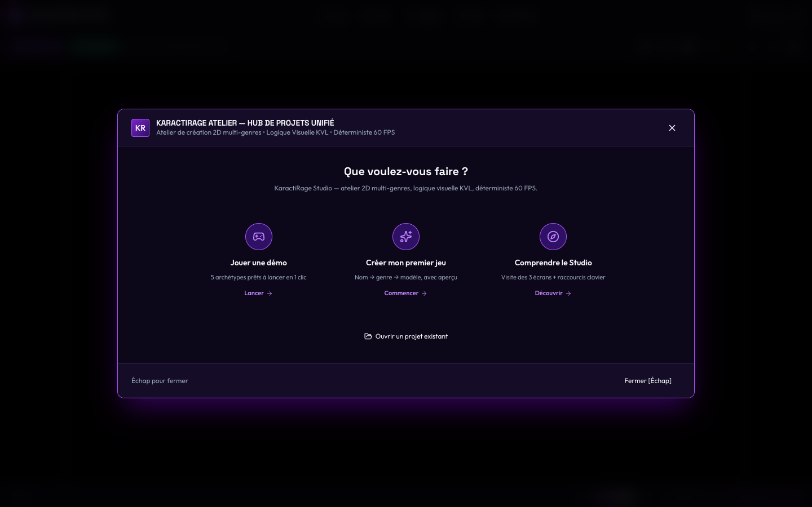
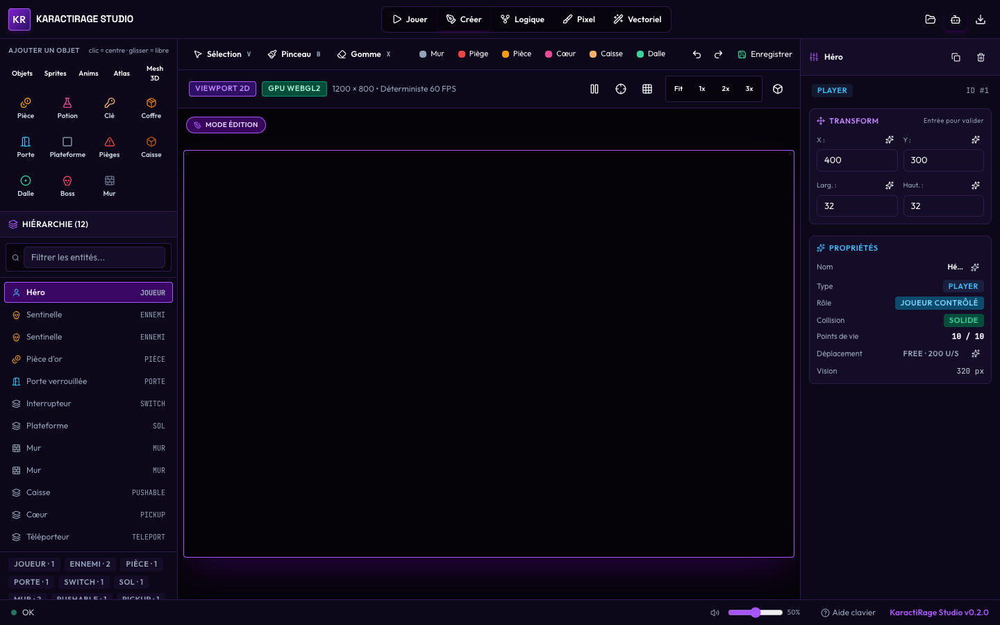
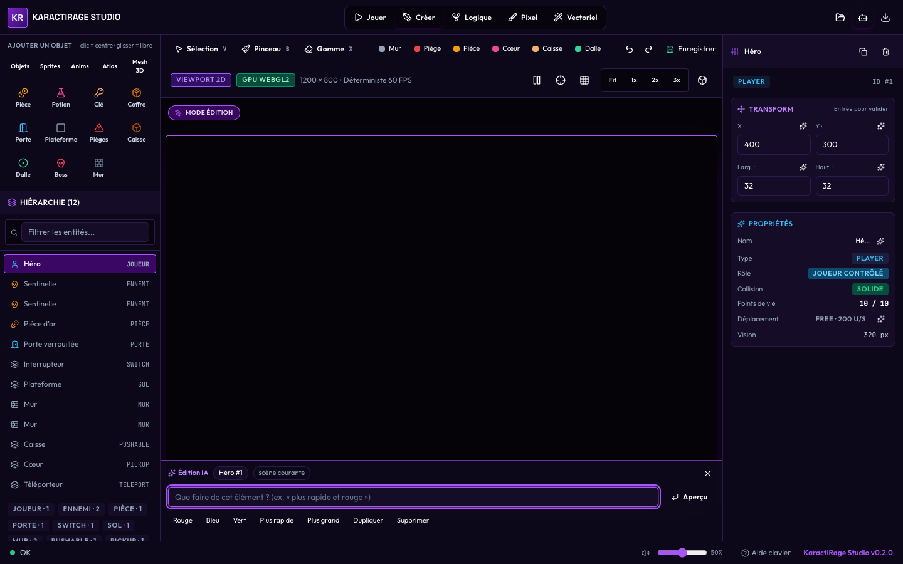
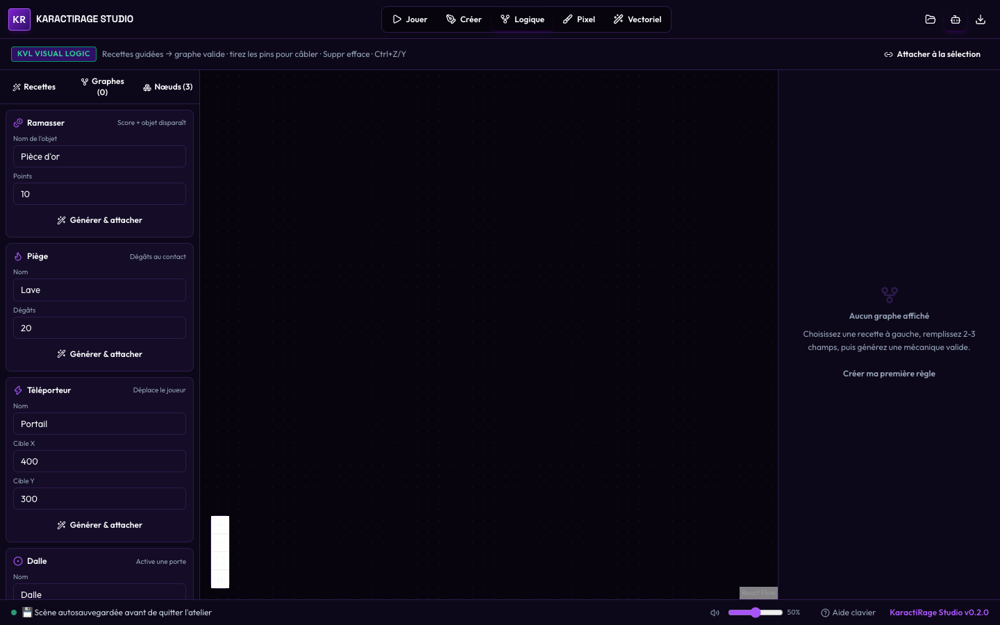
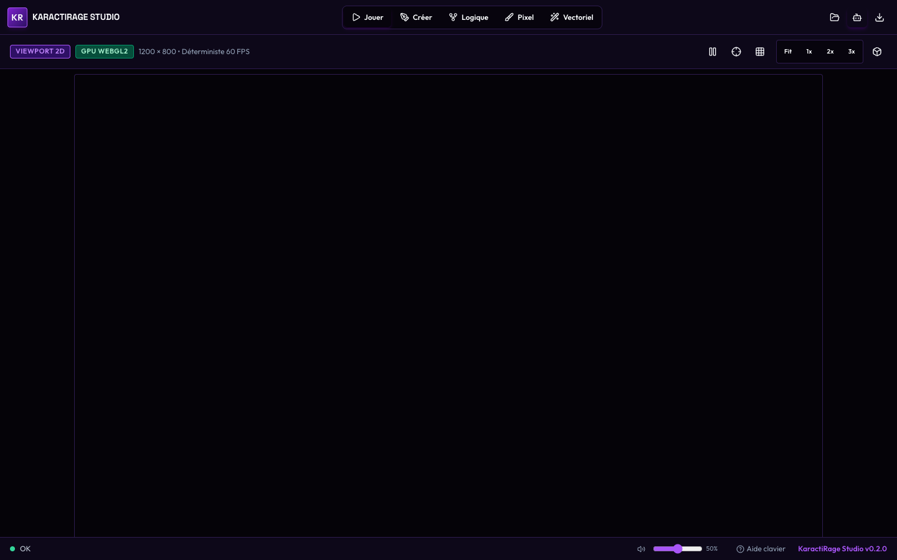

# Créer et exporter un jeu 2D en 10 minutes

> **Public** : quelqu'un qui n'a jamais ouvert KaractiRage.
> **Objectif** : passer de « rien » à un jeu jouable exporté, sans écrire de code.
> **Honnêteté** : les captures viennent du harnais d'audit automatisé (IPC simulé) ;
> les étapes, elles, sont celles du Studio réel.

---

## 0. Ce qu'il faut savoir avant de commencer

- **Le studio n'est pas un modeleur 3D.** On y assemble une scène, on écrit sa logique
  en KVL, on habille le HUD, puis on exporte.
- **Deux raccourcis suffisent** : `Ctrl+K` pour éditer avec l'IA, `F6` pour passer de
  l'atelier au jeu.
- **Tout est annulable** : une proposition IA est un aperçu ; rien n'est appliqué avant
  « Appliquer ».

## 1. Ouvrir le Studio (30 s)



Le Hub s'ouvre au lancement. Trois entrées : **Nouveau projet**, **Archétypes**
(5 jeux prêts), **Reprendre un projet**.

Pour ce tutoriel, ouvrez le jeu de référence **« Les Émeraudes du Temple »** : il
contient déjà 3 niveaux, un boss gardien et ses écrans.

## 2. Regarder la scène (1 min)



Passez en mode **Créer** (`Ctrl+2`). Vous avez :

- à gauche : la palette d'objets, la hiérarchie, les suggestions ;
- au centre : le viewport 2D (ratio 1,5, letterboxé) ;
- à droite : l'inspecteur de l'élément sélectionné.

Cliquez sur une entité : l'inspecteur affiche son transform, ses composants, sa vie,
sa vitesse. Les champs éditables portent un `✦`.

## 3. Modifier un élément avec l'IA (2 min)



Cliquez sur un `✦` (par exemple à côté de la vitesse) ou appuyez sur **`Ctrl+K`**.
La barre ancrée apparaît en bas du viewport — **le jeu reste visible**.

Tapez une demande courte : « plus rapide et rouge », « supprime », « déplace à droite ».

- La barre affiche la **cible** (« Héro #1 »), la scène et le champ visé.
- Elle propose un **aperçu** : `vitesse 110 → 165`, `couleur #475569 → #DC2626`.
- `↵` applique, `Échap` ferme sans rien faire, `Ctrl+Z` annule après application.

Si la demande sort des modèles déterministes (par exemple « crée une mécanique de saut
mural »), la barre le dit et renvoie vers l'Atelier IA (`I`) au lieu d'inventer.

## 4. Écrire la logique en KVL (2 min)



Passez en mode **Logique** (`Ctrl+3`). Le graphe du jeu de référence montre :

```text
QUAND Joueur interagit avec la porte
  ALORS niveau terminé  (SetVariable:level_complete:true)
```

C'est ce graphe qui fait avancer d'un niveau, et déclenche la victoire au dernier.
On peut le modifier à la souris ; les nœuds inconnus du catalogue sont refusés.

## 5. Jouer (30 s)



`Ctrl+1` (ou `F6`) pour jouer. Au premier lancement, le **menu** s'affiche :

- `Entrée` démarre la partie ;
- `Échap` met en pause (le monde est réellement figé) ;
- dans le jeu, `E` interagit avec la porte ;
- à la mort, l'écran de défaite propose de revenir au menu ;
- après le niveau 3, l'écran de victoire.

## 6. Régler le son (15 s)

En bas à droite du pied de page : haut-parleur (mute) + curseur de volume. Le réglage est
**persistant** et **indépendant des sauvegardes**.

## 7. Sauvegarder, reprendre (1 min)

- `Ctrl+S` enregistre la scène et les scripts KVL.
- Les parties se sauvegardent en **slots** (commande `engine_save_game`) et reprennent
  au **niveau sauvegardé**, score et variables restaurés.
  *Limite actuelle : l'écran de slots n'est pas encore dans l'interface ; les commandes
  existent côté moteur.*

## 8. Exporter (1 min)

Bouton d'export (ou `U` dans le canvas natif) :

1. **Pré-vol** : KaractiRage refuse l'export si un script KVL ou un asset référencé
   manque, et liste précisément quoi.
2. **HTML5 (données)** : un fichier unique, **sans aucune requête réseau**, qui embarque
   le jeu complet (9 entités, 2 graphes KVL, écrans).
3. **Package `.karacti`** : projet réimportable.

Vérification automatique :

```bash
cargo run -p engine-core --bin export_game -- assets/projects/jeu_reference.karacti /tmp/jeu.html
cd apps/studio && npm run export:smoke -- /tmp/jeu.html
# [export-smoke] OK — 9 entités, 0 erreur, 0 requête réseau
```

> **Ce qui n'est pas encore vrai** : le fichier HTML exporté affiche une **carte
> d'identification** (titre, entités, graphes), pas le jeu animé. Le runtime jouable
> embarqué demande une initialisation WASM sans accès disque — reporté en **P6**. Le
> Studio ne prétend plus le contraire.

## 9. Récapitulatif

| Étape | Durée | Raccourci |
|---|---|---|
| Ouvrir le Hub | 30 s | — |
| Explorer la scène | 1 min | `Ctrl+2` |
| Éditer à la volée | 2 min | `Ctrl+K` / `↵` / `Échap` |
| Logique KVL | 2 min | `Ctrl+3` |
| Jouer | 30 s | `Ctrl+1` |
| Son | 15 s | — |
| Sauvegarder | 1 min | `Ctrl+S` |
| Exporter | 1 min | `U` / bouton |

**Total : ~8 minutes**, plus le temps de lecture.
